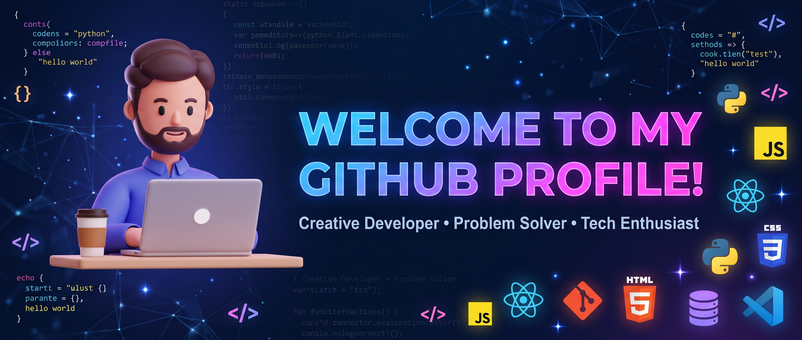

  
  
  

  
  

## 👋 About Me

Electronics & Communication Engineering graduate, building intelligence that runs *on the device* — from register-level firmware to TinyML models on microcontrollers.

- 🔧 Embedded software intern @ **Defense Industry** 
- 🌍 Exchange student in **Sweden** · IoT Research intern in **Madrid**
- 🧠 Interests: Edge AI / TinyML, signal processing, safety-critical firmware
- 💬 Ask me about: bare-metal C, SPI/I²C/UART drivers, ML on MCUs

## 🚀 Featured Projects

| Project | Description | Stack |
|---|---|---|
| [**TinyML Misfire Detection**](https://github.com/alperglcoglu/REPO_ADI) | Engine misfire detection & prediction running on a TI TMS570LC4357 | C · TensorFlow Lite Micro · TMS570 |
| [**Bare-metal STM32 SPI Driver**](https://github.com/alperglcoglu/REPO_ADI) | Register-level SPI driver for STM32F407 + STM32 ↔ ESP32-C3 link | C · STM32F407 · ESP32-C3 |
| [**HomeMate**](https://github.com/alperglcoglu/REPO_ADI) | Home-management PWA for roommates | JavaScript · PWA |

## 🛠️ Tech Stack

**Embedded**

  
  
  
  
  
  

**AI / ML**

  
  
  

**Tools**

  
  
  
  
  

## 📊 GitHub Activity

  

<picture>
  <source media="(prefers-color-scheme: dark)" srcset="https://raw.githubusercontent.com/alperglcoglu/alperglcoglu/output/github-contribution-grid-snake-dark.svg">
  <source media="(prefers-color-scheme: light)" srcset="https://raw.githubusercontent.com/alperglcoglu/alperglcoglu/output/github-contribution-grid-snake.svg">
  
</picture>
